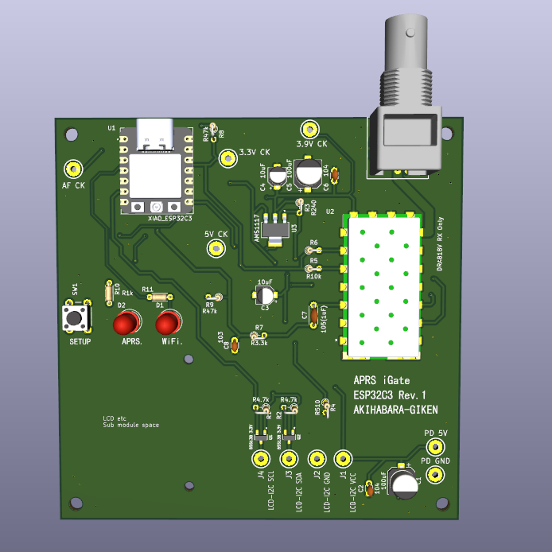

# ESP32C3 APRS iGate

**XIAO ESP32C3とDRA818Vを使用した、144.640 MHz・受信専用のAPRS iGateです。**

無線で受信したBell 202 AFSK 1200 bpsのパケットをESP32C3で復調し、Wi-Fi経由でAPRS-ISへ転送します。通常運用にPCは必要ありません。1602 LCDとWeb画面から、接続状態や受信状況を確認できます。

秋葉原技研 / PS Ham-ware — JH1HST

## 主な機能

- **144.640 MHz固定受信**：DRA818Vを起動時に自動設定
- **Bell 202 AFSK 1200 bps復調**：1200 / 2200 Hz、ADC連続DMAによる音声取得
- **AX.25解析**：NRZI、HDLC、ビットスタッフィング除去、CRC-16/X.25検証
- **APRS-IS転送**：verified認証後、受信パケットを`qAO`付きで送出
- **重複除外**：同一パケットの30秒以内の再転送を抑制
- **Web設定**：Wi-Fi、自局コールサイン、APRS-IS接続先などを設定
- **受信診断**：AF RMS、約5秒ピーク、ADC Min/Max、1200 / 2200 Hz検出値、CRCエラー、DMA overflowなど
- **状態表示**：1602 LCD、Wi-Fi LED、APRS LED
- **設定保持**：NVSへ保存し、電源再投入後も使用
- **自動復旧**：Wi-Fi / APRS-IS再接続、長時間通信不能時の再初期化・再起動

本機は**RF受信→インターネット転送専用**です。RF送信、デジピーター、INET→RFゲート、トラッカー、位置ビーコン送信は実装していません。DRA818VのPTTはハードウェアで受信状態に固定します。

## ハードウェア

| 項目 | 構成 |
| --- | --- |
| MCU | Seeed Studio XIAO ESP32C3 |
| 受信モジュール | DRA818V |
| 受信周波数 | 144.640 MHz |
| 対応信号 | Bell 202 AFSK、1200 bps、AX.25 UI / PID F0 |
| ネットワーク | 2.4 GHz Wi-Fi |
| LCD | 1602A + PCF8574 I²Cバックパック |
| 電源 | USB 5 V入力、DRA818V用約4.0 V電源 |
| 基板 | ESP32C3 Rev.1（ファームウェアの版番号とは別） |

LCD側の5 V I²Cには、BSS138による3.3 V / 5 Vレベル変換を使用します。受信音声はAC結合・バイアス回路を通してADCへ入力します。製作時の回路・電源・接続は、掲載資料を確認してください。

### ファームウェアのピン割り当て

| 用途 | XIAO端子 | ESP32C3 GPIO |
| --- | --- | --- |
| 受信AF入力 | D1 / A1 | GPIO3 / ADC1_CH3 |
| Wi-Fi LED | D2 | GPIO4 |
| APRS LED | D3 | GPIO5 |
| LCD I²C SDA | D4 | GPIO6 |
| LCD I²C SCL | D5 | GPIO7 |
| DRA818V RXDへ接続 | D6 / TX | GPIO21 |
| DRA818V TXDから接続 | D7 / RX | GPIO20 |
| SETUPボタン | D10 | GPIO10（押下でGNDへ接続） |

LEDはGPIOのHIGH出力で点灯する構成です。

## ソースコード・資料

| 内容 | 場所 |
| --- | --- |
| ファームウェア v0.3 | [ESP32C3/APRS_iGate_C3_Rev0_3](ESP32C3/APRS_iGate_C3_Rev0_3/) |
| 初期設定ガイド（PDF） | [初期設定ガイド](APRS_iGate_C3_Rev0_1_初期設定ガイド.pdf) |
| 回路資料（PDF） | [diagram.pdf](diagram.pdf) |
| 詳細説明 | [README_JA.md](ESP32C3/APRS_iGate_C3_Rev0_3/README_JA.md) |
| 更新履歴 | [CHANGELOG.md](ESP32C3/APRS_iGate_C3_Rev0_3/CHANGELOG.md) |
| 検証状況 | [TEST_NOTES.md](ESP32C3/APRS_iGate_C3_Rev0_3/TEST_NOTES.md) |
| ライセンス | [LICENSE.md](LICENSE.md) |

旧版のPDFや説明とLED動作が異なる場合、v0.3のLED動作は本READMEの表を参照してください。

## 書き込み方法

### 開発環境

- Arduino IDE 2.x（開発時使用：2.3.10）
- ボードパッケージ：**esp32 by Espressif Systems**（開発時使用：3.3.12）
- ボード：**XIAO_ESP32C3**
- USB CDC On Boot：**Enabled推奨**

WiFi / WebServer / DNSServer / ESPmDNS / Preferences / Wireなど、ESP32コアに含まれるライブラリを使用します。追加の外部Arduinoライブラリは不要です。ADC continuous APIを使用するため、ESP32コア3.xを使用してください。

### 手順

1. このリポジトリをダウンロード、またはcloneします。
2. `ESP32C3/APRS_iGate_C3_Rev0_3/APRS_iGate_C3_Rev0_3.ino`をArduino IDEで開きます。
3. 同じフォルダー内の`.h`ファイルを揃えたまま、ボードと接続ポートを選択します。
4. コンパイルしてXIAO ESP32C3へ書き込みます。
5. 必要に応じて、115200 bpsのシリアルモニターで起動ログを確認します。

通常の更新では、保存済みの設定を残すためFlash全消去は行いません。

## 初回設定

設定が未保存の場合は、設定用Wi-Fiアクセスポイントが起動します。

| 項目 | 内容 |
| --- | --- |
| SSID | `APRS-iGate-XXXX` |
| パスワード | `aprssetup` |
| 設定URL | `http://192.168.4.1/` |

1. スマートフォンやPCを設定用SSIDへ接続します。
2. ブラウザーで`http://192.168.4.1/`を開きます。
3. 運用場所のWi-Fi SSID・パスワード、自局のコールサイン（必要に応じてSSID付き）、APRS-ISパスコードを入力します。
4. 保存すると再起動し、設定したWi-FiとAPRS-ISへの接続を開始します。
5. Web画面で**Wi-Fi OK / DRA818V OK / ADC OK / APRS-IS VERIFIED**を確認します。

APRS-IS接続先の初期値は`rotate.aprs2.net`、ポートは`14580`です。GridとCommentは現行版では保存のみで、位置ビーコンには使用しません。

通常運用中は、同じLAN内から次のURLでWeb画面を開けます。

- `http://aprs-igate.local/`
- mDNSで開けない場合は、ルーターや起動ログで確認した本機のIPアドレス

## SETUPボタン

操作は**ボタンを離した時点**で判定します。

| 操作 | 動作 |
| --- | --- |
| 短押し | LCDバックライトを60秒点灯 |
| 5秒以上15秒未満の長押し | 設定用アクセスポイントを起動 |
| 15秒以上の長押し | 保存設定を消去して再起動 |

## LED表示（v0.3）

Wi-Fi接続済み・APRS-IS認証済みの場合、30秒周期で点灯します。APRS側を10秒ずらして表示します。

| 周期内の時間 | Wi-Fi LED | APRS LED |
| --- | --- | --- |
| 0秒以上10秒未満 | 点灯 | 消灯 |
| 10秒以上20秒未満 | 消灯 | 点灯 |
| 20秒以上30秒未満 | 消灯 | 消灯 |

- Wi-Fi未接続時：Wi-Fi LEDは400 msごとに点灯 / 消灯します。
- APRS-IS未接続・未認証時：APRS LEDは700 msごとに点灯 / 消灯します。
- AX.25パケット受理時：APRS LEDを短時間消灯します。もともと消灯中の場合は見た目が変わりません。

各LEDはそれぞれの接続状態に従います。**正常時も両方が消灯する時間があります。** 周期制御のために受信や通信を待機させることはありません。

## LCD・Web画面

LCDは接続状態、受信局、受信件数などを切り替えて表示します。バックライトは通常60秒で消灯し、短押しで再点灯します。

Web画面の主なカウンターは次の通りです。

| 表示 | 意味 |
| --- | --- |
| Decoded | CRCを通過し、AX.25パーサーで受理されたパケット数 |
| Gated | APRS-ISへのTCP書き込みに成功した件数 |
| Dup | 重複として転送を抑制した件数 |
| Blocked | 転送対象外として除外した件数 |
| CRC bad | フレーム候補のCRCが一致しなかった回数 |
| DMA overflow | ADCの内部データプールがあふれた回数 |

`Gated`は、上流サーバーによる受理・配信・地図表示を保証する値ではありません。CRC badは雑音でも増えるため、その数だけで受信成功率は判断できません。

受信診断枠は1秒ごとに自動更新します。現行版では、枠外の接続状態・カウンター・Last RXなどを最新にするにはページの再読み込みが必要です。

## 転送条件・運用上の範囲

- APRS-ISから`verified`が返るまではRFパケットを転送しません。
- `TCPIP` / `TCPXX` / `NOGATE` / `RFONLY`を含むパスは転送しません。
- 汎用問い合わせ（情報部の先頭が`?`）とthird-party packet（先頭が`}`）は転送しません。
- 受信ログはFlashへ蓄積せず、パケット数などは再起動でリセットされます。
- 自局位置ビーコンは送らないため、接続しただけで地図上に本機の位置が表示される構成ではありません。

## 開発・検証状況

v0.3は、基本動作を確認したファームウェアを基にした設置試験用の版です。

実機では、FIX5の段階でIC-7100のFM試験電波を受信し、AFSK復調、AX.25解析、重複除外、APRS-ISのverified認証とTCP書き込みまで確認しました。v0.2では起動完了時のLCD更新を追加し、v0.3ではLEDの点灯周期を変更しています。

v0.3のLED制御・復調回帰テストはPC上で実施済みです。v0.3のESP32向け再コンパイルは作成時点では未実施です。実際の他局信号、弱信号、長時間運転、再接続時の安定性は継続して評価します。詳細は[検証記録](ESP32C3/APRS_iGate_C3_Rev0_3/TEST_NOTES.md)を参照してください。

## ライセンス・関連リンク

利用条件は[PS Ham-ware / AKIHABARA-GIKEN License](LICENSE.md)に従います。個人の学習・研究・アマチュア無線用途での製作・実行・改変が許可されています。営利利用、元データの再配布、改変物の公開・配布には事前の許可が必要です。詳細はライセンス本文を確認してください。

- [PS Ham-ware](https://2jp.org/ps/)
- [秋葉原技研](https://2jp.org/js1yjy/)
- [不具合報告・改善提案](https://github.com/na2jpn/ESP32C3_APRS-igate/issues)
